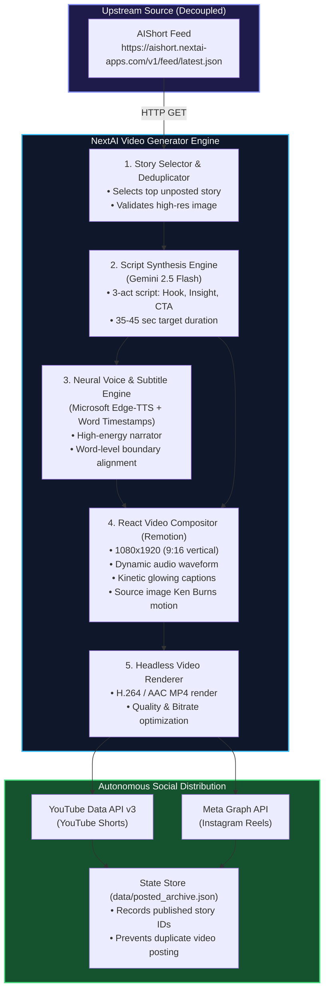

# NextAI Video Generator — Architectural Specification

> **Autonomous End-to-End Pipeline**: Transforms daily AI news from the AIShort feed into viral, high-production 9:16 vertical explainer videos (YouTube Shorts & Instagram Reels) with zero human intervention.

---

## 1. Core Architectural Principles

1. **Strict Decoupling**: The video pipeline is completely independent of the AIShort monorepo. It consumes the public, immutable feed contract (`https://aishort.nextai-apps.com/v1/feed/latest.json`) over standard HTTPS. If AIShort changes its database or internal architecture, the video engine remains unaffected.
2. **Zero-Touch Automation**: From news ingestion to social media publishing, the pipeline runs autonomously on a scheduled trigger (GitHub Actions cron or cloud worker) without requiring daily manual clicks.
3. **Cost Efficiency & Free-Tier First**:
   * **Scripting**: Google Gemini 2.5 Flash (sub-cent cost per video).
   * **Voice Synthesis**: Microsoft Edge-TTS (100% free neural voices with zero character limits).
   * **Video Rendering**: Remotion (React-driven headless video engine) or FFmpeg.
   * **Hosting/Compute**: GitHub Actions runner (2,000 free minutes/month).
4. **Editorial Anti-Fatigue Design**: Avoids generic, cheap AI stock footage. Videos use modern kinetic typography (MrBeast/Alex Hormozi style glowing subtitles), Ken Burns pans over verified article source images, audio waveforms, and dark studio aesthetic (`#090a0f` matching the NextAI design system).

---

## 2. End-to-End Data Flow



---

## 3. Component Deep Dive

### 3.1 Story Selection & State Deduplication
* **Source**: Polls `https://aishort.nextai-apps.com/v1/feed/latest.json`.
* **Selection Heuristic**:
  1. Filters out story IDs already present in `data/posted_archive.json`.
  2. Prioritizes stories with valid `imageUrl` and category `Models` or `Research` (highest viral engagement).
  3. Ranks by word balance and verified source credibility.
* **Output**: Selected `Card` object.

### 3.2 Script Synthesis Engine (Gemini 2.5 Flash)
* Takes the verified 60-word briefing and headline.
* Prompts Gemini with strict pacing guidelines (130–150 words per minute spoken cadence):
  * **Act 1: The Hook (0–4s)**: Disruptive 1-sentence opening question or bold claim.
  * **Act 2: The Core Breakdown (5–28s)**: 3 punchy takeaways with concrete numbers (e.g. *"94.2% benchmark score"*, *"10x speed boost"*).
  * **Act 3: The Call to Action (29–38s)**: *"Follow for daily AI breakthroughs, and read the 60-word briefing on the AIShort app."*
* Returns structured JSON with spoken text, visual cues, and suggested hashtags.

### 3.3 Neural Voice & Word-Level Timing (`edge-tts`)
* Uses Microsoft's neural voice model (`en-US-ChristopherNeural` or `en-US-GuyNeural`).
* Captures word-level timing offsets (`Offset` and `Duration`) from the audio stream.
* Produces:
  1. `audio.mp3`: Broadcast-quality voiceover track.
  2. `subtitles.json`: Array of `{ word, startMs, endMs }` for frame-accurate caption synchronization.

### 3.4 Visual Composition Engine (Remotion / React)
* **Canvas Resolution**: `1080 × 1920` (standard 9:16 vertical aspect ratio).
* **Frame Rate**: `30 FPS`.
* **Layer Stack**:
  1. **Background**: Dark violet/obsidian gradient (`#0a0a12`) with subtle animated radial glow.
  2. **Hero Visual**: Story source image with smooth slow pan-and-zoom (Ken Burns effect) inside a rounded frosted glass card (`border: 1px solid rgba(255,255,255,0.1)`).
  3. **Branding Pill**: Top floating pill `⚡ AIShort Daily · 60s Briefing`.
  4. **Dynamic Waveform**: Real-time reactive audio visualizer synced to voice frequencies.
  5. **Kinetic Caption Overlay**: Words scale up as spoken with glowing cyan highlight (`#38bdf8`) on the active word.
  6. **Outro Card**: NextAI Apps Studio logo + app install CTA.

### 3.5 Headless Rendering & Distribution
* **Remotion CLI / Bundler**: Compiles the React composition to an MP4 video in ~30–45 seconds.
* **YouTube Shorts Publisher**:
  * Uploads to YouTube channel using YouTube Data API v3 (`videos.insert`).
  * Automatically sets title with `#Shorts`, rich description with link to `https://aishort.nextai-apps.com/`, and AI tags.
* **Instagram Reels Publisher**:
  * Uploads via Meta Graph API container workflow:
    1. `POST /{ig-user-id}/media` (video_url, media_type=REELS, caption).
    2. `POST /{ig-user-id}/media_publish`.

---

## 4. Contract Specifications

### 4.1 Inbound Feed Schema (from AIShort)
```json
{
  "id": "anthropic-claude-3-7-sonnet",
  "headline": "Anthropic Unveils Claude 3.7 Sonnet with Hybrid Reasoning",
  "summary": "Anthropic announced Claude 3.7 Sonnet, introducing unified standard and extended thinking modes in a single model. Benchmark evaluations reveal top performance in coding and mathematical reasoning.",
  "category": "Models",
  "sourceName": "Anthropic Research",
  "sourceUrl": "https://www.anthropic.com/news/claude-3-7-sonnet",
  "imageUrl": "https://images.unsplash.com/...",
  "publishedAt": "2026-11-11T12:00:00Z"
}
```

### 4.2 Intermediate Video Job Manifest
```json
{
  "jobId": "video_20261112_001",
  "storyId": "anthropic-claude-3-7-sonnet",
  "script": {
    "hook": "Anthropic just solved AI's biggest reasoning bottleneck.",
    "body": "Claude 3.7 Sonnet is here, and it's the first model to combine instant answers with extended deep thinking in one single prompt.",
    "cta": "Read the full 60-word briefing on the AIShort app at aishort.nextai-apps.com."
  },
  "audioPath": "build/audio.mp3",
  "durationSeconds": 34.5,
  "subtitles": [
    { "word": "Anthropic", "startMs": 120, "endMs": 480 },
    { "word": "just", "startMs": 490, "endMs": 680 }
  ],
  "renderStatus": "completed",
  "videoPath": "build/output_1080x1920.mp4"
}
```

---

## 5. Security & Isolation

* **Zero AIShort Code Access**: The video generator does not have git access or write permissions to the AIShort repo.
* **Secrets Isolation**:
  * `GEMINI_API_KEY`: Stored in repository secrets for script generation.
  * `YOUTUBE_CLIENT_ID` / `YOUTUBE_CLIENT_SECRET` / `YOUTUBE_REFRESH_TOKEN`: Stored in repository secrets.
  * `INSTAGRAM_ACCESS_TOKEN` / `INSTAGRAM_ACCOUNT_ID`: Stored in repository secrets.
* **Failure Handling**:
  * If YouTube or Instagram API fails, the generated video is preserved in GitHub Action artifacts for 7 days with error logs, allowing 1-click manual retry.

