# NextAI Video Generator — Detailed Implementation Plan

> **Goal**: Build an autonomous, zero-human-effort video generator that consumes daily verified AI news from the `AIShort` feed (`https://aishort.nextai-apps.com/v1/feed/latest.json`), synthesizes viral vertical video scripts via Gemini 2.5 Flash, renders high-production 9:16 vertical videos with Remotion and Microsoft Edge-TTS, and posts them to YouTube Shorts and Instagram Reels on a scheduled cron.

---

## 1. Project Overview & Boundaries

- **Repository**: `sverma9312/nextai-video-generator` (Private)
- **Local Directory**: `D:\CODE\CurrentWorkspace\nextai-video-generator`
- **Decoupling Guarantee**: The video generator interacts with `AIShort` **only** via the public, immutable HTTP endpoint (`https://aishort.nextai-apps.com/v1/feed/latest.json`). It does not import, depend on, or have write access to the `AIShort` repository or its internal database.
- **Operating Cost Target**: \$0 recurring compute / speech cost (Edge-TTS is 100% free; Gemini 2.5 Flash operates within sub-cent limits or free tier; GitHub Actions provides 2,000 monthly runner minutes).

---

## 2. Implementation Phases

```mermaid
flowchart LR
    P1["Phase 1\nFeed Consumer &\nDeduplication"] --> P2["Phase 2\nGemini 2.5 Flash\nScript Synthesis"]
    P2 --> P3["Phase 3\nNeural Voice &\nWord Timestamps"]
    P3 --> P4["Phase 4\nRemotion React\n9:16 Compositor"]
    P4 --> P5["Phase 5\nHeadless Render &\nCLI Pipeline"]
    P5 --> P6["Phase 6\nSocial Distribution\n(YT & IG)"]
    P6 --> P7["Phase 7\nGitHub Actions\nAutonomous Cron"]

    style P1 fill:#1e1b4b,stroke:#818cf8,stroke-width:1px,color:#fff
    style P2 fill:#0f172a,stroke:#38bdf8,stroke-width:1px,color:#fff
    style P3 fill:#1e293b,stroke:#94a3b8,stroke-width:1px,color:#fff
    style P4 fill:#312e81,stroke:#a855f7,stroke-width:1px,color:#fff
    style P5 fill:#064e3b,stroke:#34d399,stroke-width:1px,color:#fff
    style P6 fill:#701a75,stroke:#f472b6,stroke-width:1px,color:#fff
    style P7 fill:#14532d,stroke:#4ade80,stroke-width:2px,color:#fff
```



---

### Phase 1: Ingestion & Feed Consumer (Decoupled Data Layer)
- **Objective**: Fetch live daily news from AIShort, validate required fields, and filter out stories that have already been converted into videos.
- **Deliverables**:
  1. `src/feed/consumer.ts`:
     - Fetches `https://aishort.nextai-apps.com/v1/feed/latest.json` with timeout, user-agent, and retry logic.
     - Type definitions for `FeedCard` (`id`, `headline`, `summary`, `category`, `imageUrl`, `sourceName`, `sourceUrl`, `publishedAt`).
  2. `src/feed/archive.ts`:
     - Reads/writes `data/posted_archive.json`.
     - Maintains a record of `{ storyId, videoTitle, postedAt, youtubeUrl?, instagramId? }`.
     - Prevents duplicate video generation for the same news card.
  3. `src/feed/selector.ts`:
     - Selects the single best unposted candidate based on image resolution, category engagement (`Models` or `Research` prioritized), and recency.
- **Exit Criteria**: Running `pnpm test:feed` outputs a validated, unposted story card ready for script generation.

---

### Phase 2: Script Synthesis Engine (Gemini 2.5 Flash)
- **Objective**: Transform a 60-word verified news card into a high-retention 35–45 second vertical video script with viral pacing.
- **Deliverables**:
  1. `src/script/prompt.ts`:
     - System prompt tailored for short-form retention:
       - **Act 1: Hook (0–4s)**: High-curiosity question or shocking revelation.
       - **Act 2: The Meat (5–28s)**: 2–3 concise, concrete facts (numbers, benchmarks, practical impacts).
       - **Act 3: Call to Action (29–38s)**: Clear outro directing viewers to install/open AIShort for the full 60-word briefing.
  2. `src/script/generator.ts`:
     - Uses `@google/genai` (official Google Gen AI SDK) with model `gemini-2.5-flash`.
     - Enforces structured JSON output matching schema:
       ```json
       {
         "hook": "string",
         "scriptBody": "string",
         "cta": "string",
         "fullSpokenText": "string",
         "videoTitle": "string",
         "videoDescription": "string",
         "hashtags": ["string"]
       }
       ```
     - Includes automatic JSON schema validation and retry fallback.
- **Exit Criteria**: Given any AIShort card, produces a punchy 80–110 word spoken script with viral title and hashtags.

---

### Phase 3: Neural Voice Synthesis & Word-Level Timing (Microsoft Edge-TTS)
- **Objective**: Generate crisp, broadcast-quality voiceover audio with millisecond word timestamps at zero cost.
- **Deliverables**:
  1. `src/audio/tts.ts`:
     - Node.js wrapper for Microsoft Edge-TTS (`edge-tts` or `edge-tts-node`).
     - Uses default neural voice `en-US-ChristopherNeural` or `en-US-GuyNeural` (energetic, clear tech cadence).
     - Audio output: 44.1kHz / 48kHz stereo `audio.mp3`.
  2. `src/audio/subtitles.ts`:
     - Parses the Edge-TTS metadata stream to extract exact word start and end offsets:
       ```json
       [
         { "word": "Anthropic", "startMs": 100, "endMs": 420 },
         { "word": "just", "startMs": 430, "endMs": 620 }
       ]
       ```
     - Groups words into dynamic subtitle chunks (2–4 words per screen) matching high-retention TikTok/Reels subtitle pacing.
- **Exit Criteria**: Produces an audible `build/audio.mp3` and corresponding frame-accurate `build/subtitles.json`.

---

### Phase 4: Remotion React Video Compositor (1080x1920 9:16)
- **Objective**: Programmatically construct modern, studio-grade video frames in React with animations, dynamic waveforms, and kinetic captions.
- **Deliverables**:
  1. Remotion root & composition setup (`src/video/Root.tsx`, `src/video/Composition.tsx`):
     - Resolution: `1080 × 1920` (9:16 vertical).
     - Framerate: `30 FPS`.
     - Dynamic frame calculation based on audio duration: `Math.ceil(durationSeconds * 30)`.
  2. Visual Components:
     - `src/video/components/Background.tsx`: Dark obsidian gradient (`#07080d`) with subtle drifting particles and neon glow.
     - `src/video/components/HeroCard.tsx`: Floating frosted glass card featuring the news source image with continuous Ken Burns slow zoom/pan.
     - `src/video/components/HeaderPill.tsx`: Sleek top banner (`⚡ AIShort Daily Briefing`).
     - `src/video/components/Waveform.tsx`: Real-time reactive audio visualizer reacting to the voiceover frequencies.
     - `src/video/components/KineticSubtitles.tsx`: Bold, glowing typography with active-word accent color highlighting (`#38bdf8` / `#818cf8`).
     - `src/video/components/OutroCard.tsx`: AIShort branding, app store pill, and follow call-to-action.
- **Exit Criteria**: Remotion preview server (`pnpm remotion preview`) opens in browser and renders the video in real-time with flawless audio sync.

---

### Phase 5: Headless CLI & Local Rendering Pipeline
- **Objective**: A single command that runs the entire pipeline locally, outputting an MP4 video file.
- **Deliverables**:
  1. `src/render/bundle.ts`:
     - Uses `@remotion/bundler` and `@remotion/renderer` to render headless MP4 videos.
     - Encodes with `H.264` and `AAC` audio for universal social platform compatibility.
  2. `src/cli.ts`:
     - CLI with commands:
       - `pnpm generate:latest`: Fetches top unposted news, generates script, audio, and renders MP4 to `out/<story-id>.mp4`.
       - `pnpm generate:dry-run`: Generates script and audio without rendering MP4 (fast verification).
- **Exit Criteria**: Running `pnpm generate:latest` outputs an optimized `out/video.mp4` ready for playback and upload.

---

### Phase 6: Autonomous Social Distribution (YouTube & Instagram)
- **Objective**: Automatically upload the rendered video to social platforms with proper tags and descriptions.
- **Deliverables**:
  1. `src/social/youtube.ts`:
     - Integrates with YouTube Data API v3 (`googleapis`).
     - Uploads MP4 to channel as `#Shorts`.
     - Populates Title, rich description (with source attribution and link to `https://aishort.nextai-apps.com/`), and AI tags.
     - Sets privacy status to `public` (or configurable `unlisted` for staging).
  2. `src/social/instagram.ts`:
     - Integrates with Meta Graph API (Instagram Graph API).
     - Uses Instagram Reels Publishing container endpoint (`POST /{ig-user-id}/media` + `POST /{ig-user-id}/media_publish`).
  3. `src/social/publisher.ts`:
     - Orchestrates uploads and updates `data/posted_archive.json` upon success.
- **Exit Criteria**: Validated upload function successfully posts a test short to YouTube and Instagram.

---

### Phase 7: GitHub Actions Autonomous Cron & CI/CD
- **Objective**: Schedule the entire pipeline to run daily on GitHub's hosted runners without human intervention.
- **Deliverables**:
  1. `.github/workflows/daily-video.yml`:
     - Scheduled cron trigger (e.g. daily at 09:00 UTC / 14:30 IST).
     - `workflow_dispatch` trigger for manual 1-click execution.
     - Steps:
       1. Checkout repo with write permissions.
       2. Setup Node.js & Python (for Edge-TTS).
       3. Run `pnpm install`.
       4. Run `pnpm run pipeline:daily`.
       5. Save rendered video as GitHub Actions Artifact (retained for 7 days).
       6. Auto-commit updated `data/posted_archive.json` back to `main`.
- **Exit Criteria**: GitHub Action runs cleanly on schedule, renders video, publishes, commits archive state, and logs summary.

---

## 3. Technology Stack & Dependencies

| Layer | Technology | Cost | Reason |
| :--- | :--- | :--- | :--- |
| **Language & Runtime** | TypeScript, Node.js v20+ | Free | Type safety, shared ecosystem with Remotion |
| **Feed Ingestion** | Native `fetch` / Axios | Free | Zero dependencies, fast HTTP calls |
| **AI Script Generation** | `@google/genai` (Gemini 2.5 Flash) | Free / < \$0.001 | Ultra-fast, high reasoning, low cost |
| **Voice Synthesis** | Microsoft Edge-TTS | Free | High-quality neural voices, zero character limit, word offsets |
| **Video Compositor** | Remotion (`@remotion/renderer`) | Free | React-based programmatic video, deterministic rendering |
| **Video Codec** | H.264 / AAC via FFmpeg | Free | Remotion bundles FFmpeg automatically |
| **YouTube Upload** | `googleapis` (YouTube Data API v3) | Free | 10,000 free quota units/day (~6 Shorts/day) |
| **Instagram Upload** | Meta Graph API (v19+) | Free | Direct Reels container API |
| **Autonomous Runner** | GitHub Actions | Free | 2,000 runner minutes/month |

---

## 4. Environment Variables Specification

```ini
# Gemini API
GEMINI_API_KEY="your-gemini-api-key"

# YouTube Data API v3 (OAuth2 Client)
YOUTUBE_CLIENT_ID="your-client-id.apps.googleusercontent.com"
YOUTUBE_CLIENT_SECRET="your-client-secret"
YOUTUBE_REFRESH_TOKEN="your-refresh-token"
YOUTUBE_PRIVACY_STATUS="public" # or unlisted

# Instagram Graph API
INSTAGRAM_ACCOUNT_ID="your-instagram-business-account-id"
INSTAGRAM_ACCESS_TOKEN="your-long-lived-page-access-token"

# Pipeline Settings
VIDEO_TARGET_DURATION_SEC="38"
VIDEO_VOICE_NAME="en-US-ChristopherNeural"
DRY_RUN="false"
```

---

## 5. Risk Assessment & Mitigations

1. **YouTube API Quota Depletion**:
   - *Risk*: YouTube Data API grants 10,000 units/day. A video upload costs 1,600 units.
   - *Mitigation*: We post 1–2 high quality videos per day (~3,200 units), comfortably within the free 10,000 daily limit.
2. **Missing Source Image in Inbound News**:
   - *Risk*: A news article from the feed might have a broken or missing `imageUrl`.
   - *Mitigation*: Story Selector automatically rejects items without verified, high-res images, falling back to the next unposted story.
3. **Audio-Video Desynchronization**:
   - *Risk*: Subtitles drift out of sync if frame rate differs from audio sample rate.
   - *Mitigation*: Millisecond-accurate word boundaries from Edge-TTS metadata are converted to exact frame numbers via `Math.floor((ms / 1000) * FPS)`.
4. **Platform Ban or Flagging for Pure AI Content**:
   - *Risk*: Platforms downrank low-effort slideshows.
   - *Mitigation*: Videos are designed with real news source attribution, verified 60-word briefings, human-sounding energetic pacing, dynamic waveforms, and custom branded styling matching NextAI Apps Studio.
